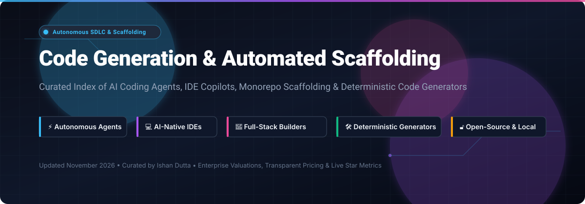

  

# 🚀 Awesome Code Generation & Automated Scaffolding

  
  
  
  
  
  
  

---

## 📑 Table of Contents
- [📌 Overview & SEO Summary](#-overview--seo-summary)
- [📊 Sector Overview & Market Dynamics](#-sector-overview--market-dynamics)
- [🏢 SaaS & Hosted Platforms](#-saas--hosted-platforms)
- [🔓 Open-Source GitHub Projects](#-open-source-github-projects)
- [🤝 How to Contribute](#-how-to-contribute)
- [💖 Support & Sponsorship](#-support--sponsorship)
- [⭐ Star History](#-star-history)
- [⚖️ Disclaimer](#️-disclaimer)

---

## 📌 Overview & SEO Summary

Welcome to the definitive **Awesome Code Generation & Automated Scaffolding** index! 🤖⚡

This curated knowledge base tracks high-performance **SaaS/hosted platforms**, **autonomous software engineering agents (SWE agents)**, **AI-native IDEs**, **deterministic project scaffolders**, and **open-source copilots**. Whether you are looking for enterprise cloud coding assistants (GitHub Copilot, Cursor, Windsurf, Devin), browser-based prompt-to-app generators (v0, Replit, Lovable), or privacy-preserving local LLM CLI tools and monorepo scaffolding engines (OpenCode, Cline, OpenHands, Aider, Tabby, Nx, Cookiecutter), this repository indexes their starting pricing, free plan quotas, company valuations, and real-time open-source community adoption.

**Key Technology Categories Covered:**
- 🧠 **AI Code Generation & Autocomplete**: Next-token and multi-line intelligent completion across VS Code, JetBrains, and terminal environments.
- 🤖 **Autonomous SWE Agents**: End-to-end agents equipped with sandboxed terminals, browser environments, and multi-file code editing abilities.
- 🏗️ **Automated Project Scaffolding**: Prompt-to-full-stack app generators provisioning databases, authentication, routing, and deployment configurations.
- 📐 **Deterministic Code & Boilerplate Generators**: AST-based micro-generators, OpenAPI client SDK synthesizers, and production-tested repository templates.
- 🛡️ **Local & Air-Gapped AI Assistants**: Zero-data-retention, self-hosted LLM assistants powered by Ollama, vLLM, and local GPU pipelines.

---

## 📊 Sector Overview & Market Dynamics

> **Market Valuation & Growth Trajectory**: The global AI Code Generation and automated developer tooling market is valued at approximately **$8.14 billion in 2025** and projected to surpass **$10.1 billion in 2026**, growing at a rapid CAGR of **~25%–27%** through 2032.
>
> **Market Fragmentation & Competitive Dynamics**: The sector exhibits a distinctive **bifurcated market structure**:
> 1. **Concentrated Foundation & Infrastructure Layer**: Frontier foundational models and deep OS/enterprise developer distribution channels remain heavily consolidated among hyperscalers and key tech giants (Microsoft/GitHub, Amazon AWS, Google, OpenAI, and Anthropic).
> 2. **Highly Fragmented Tooling & Agent Execution Layer**: The developer application layer is decidedly **not** winner-take-all. Intense fragmentation thrives between AI-first IDE forks (Cursor, Windsurf), terminal-native autonomous agent CLI tools (OpenCode, Aider, Goose), prompt-to-app web workspaces (v0, Bolt, Lovable, Replit), and sovereign, self-hosted open-source stacks (Continue, OpenHands, Tabby). Developers continuously rotate between specialized tools depending on language ecosystems, workflow ergonomics, privacy constraints, and enterprise security needs.

---

## 🏢 SaaS & Hosted Platforms

The table below catalogs premier hosted AI coding assistants, autonomous agents, and cloud app generators. Sorted in descending order by **Company Size / Valuation / Capitalization**.

| 🏢 Platform | 🏷️ Description | 💰 Starting Tier Price | 🎁 Free Tier Limit / Trial Duration | 📈 Company Size (Valuation / Revenue / Market Cap) |
| :--- | :--- | :--- | :--- | :--- |
| **[Amazon Q Developer](https://aws.amazon.com/q/developer/)** | ☁️ AWS-integrated cloud developer assistant offering inline completions, CLI agents, Java/Python version upgrades, and automated security scans. | **$19/user/month** (Pro Tier) | **Perpetual Free Tier**: 50 agentic requests/month, 1,000 lines of code transformation/month, 50 security scans/month via AWS Builder ID. | **~$2.1 Trillion Market Cap** (Amazon / AWS Enterprise Division) |
| **[GitHub Copilot](https://github.com/features/copilot)** | 💻 Ubiquitous cloud AI pair programmer providing IDE autocomplete, multi-file workspace editing, pull request reviews, and CLI guidance. | **$10/user/month** (Copilot Pro) | **Perpetual Free Tier**: 2,000 code completions/month and 50 chat/agent requests/month in VS Code / JetBrains. | **~$3.1 Trillion Market Cap** (Parent Microsoft) / Est. **$1.5B+ Copilot ARR** |
| **[Cursor](https://www.cursor.com)** | ⚡ AI-native code editor built as a customized VS Code fork featuring Composer multi-file synthesis, semantic codebase indexing, and tab prediction. | **$20/user/month** (Pro Tier) | **Perpetual Free Plan (Hobby)**: 2,000 completions/month and 50 slow/standard requests/month with 14-day Pro trial (500 fast requests). | **~$50 Billion Valuation** (Anysphere, backed by a16z, Thrive, and Benchmark) |
| **[Devin](https://preview.devin.ai)** | 🤖 Autonomous AI software engineer by Cognition equipped with a sandboxed shell, editor, browser, and end-to-end bug/feature resolution. | **$20/month** (Devin Pro) | **14-day Free Sandbox Trial**: Limited individual evaluation credits; enterprise trials provisioned via custom demo access. | **~$48 Billion Valuation** (Cognition AI, Series E round) |
| **[Replit Agent](https://replit.com)** | 🌐 Cloud IDE autonomous full-stack scaffolder that configures databases, installs packages, codes UI/APIs, and deploys live apps from prompts. | **$20/month** (Replit Core, billed annually) | **Perpetual Free Starter Tier**: Basic public Repl workspaces, free community compute, plus limited 3-day initial Agent promotional trial. | **~$9 Billion Valuation** (Replit, Series D funding) |
| **[v0 (by Vercel)](https://v0.dev)** | 🎨 Generative UI and full-stack Next.js/React application scaffolding engine producing production-ready Tailwind components with live previews. | **$20/user/month** (v0 Premium Tier) | **Perpetual Free Hobby Plan**: $5 monthly free credits renewed every month (equivalent to ~200 chat/generation credits/month). | **~$3.25 Billion Valuation** (Vercel, Series E funding) |
| **[Windsurf (by Codeium)](https://codeium.com/windsurf)** | 🏄 Agentic IDE and editor powered by Cascade flows for deep multi-file contextual refactoring, terminal execution, and local reasoning. | **$20/user/month** (Windsurf Pro) | **Perpetual Free Tier**: Unlimited standard autocomplete, plus 25 monthly Cascade agentic prompt credits / 2-week Pro trial. | **~$2.85 Billion Valuation** (Codeium, Series C / extension rounds) |
| **[Magic.dev](https://magic.dev)** | 🧠 Frontier AI research lab building ultra-long-context models (LTM-2-mini) for whole-repository architectural reasoning and massive code synthesis. | **$25/seat/month** (Enterprise Developer Starting Tier) | **Invite-Only Closed Developer Sandbox**: Free waitlist pilot access with private compute allocation granted upon application approval. | **~$1.5 Billion Valuation** (Magic AI, Series C backed by Eric Schmidt and CapitalG) |
| **[Tabnine](https://www.tabnine.com)** | 🔒 Privacy-first enterprise AI code assistant with zero-data-retention, private VPC isolation, and on-premises custom fine-tuning options. | **$39/user/month** (Code Assistant, billed annually) | **90-Day Free Enterprise Trial**: 90 days unrestricted access for teams; basic individual starter tier with limited daily chat/autocomplete completions. | **~$250 Million Valuation** (Series B, backed by Telstra Ventures, Atlassian, Qualcomm) |
| **[Factory AI](https://factory.ai)** | 🏭 Enterprise autonomous coding droid platform automating sprint tasks, legacy system migrations, test writing, and pull request generation. | **$20/user/month** (Factory Pro Tier) | **14-Day Free Trial**: 14-day access to standard Droid runners with up to 50 autonomous automated agent execution runs. | **~$120 Million Valuation** (Backed by Sequoia Capital and prominent angels) |

---

## 🔓 Open-Source GitHub Projects

The table below ranks notable open-source code generation, autonomous coding assistants, and automated scaffolding projects. Ranked in descending order by **GitHub Stars_Counts** (live social badges link directly to each project's Stargazers directory).

| 📦 Repository & Name | ⭐ Stars_Count | 🛠️ Category / Focus | 📝 Description |
| :--- | :--- | :--- | :--- |
| **[sst/opencode](https://github.com/sst/opencode)** |  | 🤖 Autonomous CLI Coding Agent | Terminal-first autonomous coding agent built for rapid software development, file refactoring, and automated deployment scripting. |
| **[shadcn-ui/ui](https://github.com/shadcn-ui/ui)** |  | 🎨 Component & App Scaffolding CLI | Groundbreaking CLI scaffolder that copies customizable, accessible Tailwind CSS + Radix UI components directly into full-stack codebases. |
| **[All-Hands-AI/OpenHands](https://github.com/All-Hands-AI/OpenHands)** |  | 🤖 Open-Source SWE Agent Platform | Full-featured autonomous software development agent equipped with a sandboxed Docker execution environment, bash shell, editor, and web browser. |
| **[cline/cline](https://github.com/cline/cline)** |  | 🧩 Agentic VS Code Extension & CLI | Autonomous coding agent extension for VS Code that reads codebases, writes multi-file features, runs terminal commands, and checks visual output. |
| **[aaif-goose/goose](https://github.com/aaif-goose/goose)** |  | 🪿 Extensible MCP Developer Agent | Open-source on-machine AI agent designed to go beyond suggestions by executing terminal scripts, inspecting databases, and editing files via MCP tools. |
| **[gpt-engineer-org/gpt-engineer](https://github.com/gpt-engineer-org/gpt-engineer)** |  | 🏗️ Natural Language App Builder | Seminal CLI tool that asks clarifying architectural questions to scaffold complete, runnable codebases from high-level natural language prompts. |
| **[Aider-AI/aider](https://github.com/Aider-AI/aider)** |  | 💻 Terminal AI Pair Programming | Highly productive terminal AI pair-programmer that maps git repositories via tree-sitter AST, edits multiple files, and crafts clean git commits. |
| **[continuedev/continue](https://github.com/continuedev/continue)** |  | 🔌 Open-Source Copilot for IDEs | Modular coding assistant extension for VS Code and JetBrains supporting local models (Ollama, vLLM) or commercial frontier LLMs with tab-autocomplete. |
| **[TabbyML/tabby](https://github.com/TabbyML/tabby)** |  | 🏠 Self-Hosted AI Autocomplete Engine | Self-hosted, lightweight AI coding assistant server written in Rust with fast local GPU inference, enterprise SSO, and repository indexing. |
| **[nrwl/nx](https://github.com/nrwl/nx)** |  | 🏢 Smart Monorepo Scaffolder | Enterprise monorepo build system and architectural scaffolding engine with automated code generators, AST migration scripts, and dependency graph analysis. |
| **[voideditor/void](https://github.com/voideditor/void)** |  | 🖥️ Open-Source AI-Native IDE | Community-driven, privacy-preserving open-source alternative to Cursor built on VS Code, connecting seamlessly to local and hosted models. |
| **[OpenAPITools/openapi-generator](https://github.com/OpenAPITools/openapi-generator)** |  | 📜 Multi-Language SDK Generator | Deterministic code generator that synthesizes API client libraries, server stubs, OpenAPI boilerplate, and documentation across 50+ programming languages. |
| **[cookiecutter/cookiecutter](https://github.com/cookiecutter/cookiecutter)** |  | 🍪 Deterministic Repository Templating | Industry-standard command-line utility for cross-platform project templating, bootstrapping microservices and Python packages cleanly from Git templates. |
| **[dyad-sh/dyad](https://github.com/dyad-sh/dyad)** |  | 📱 Local-First AI App Builder | Free, local-first open-source web application builder and scaffolder (v0 / Lovable / Bolt alternative) running on desktop with local or cloud models. |
| **[stackblitz-labs/bolt.diy](https://github.com/stackblitz-labs/bolt.diy)** |  | ⚡ In-Browser App Scaffolder | Community-driven open-source edition of Bolt.new that prompts, scaffolds, executes, and deploys full-stack Node/browser apps using any custom LLM. |
| **[plopjs/plop](https://github.com/plopjs/plop)** |  | 🗂️ Micro-Generator Framework | Fast, consistent codebase micro-generator leveraging Handlebars templates to scaffold uniform components, controllers, test suites, and route handlers. |
| **[jondot/hygen](https://github.com/jondot/hygen)** |  | ⚡ Scalable Code Generator | Blazing fast, contextual code generator living right inside your project repository with simple Markdown frontmatter templates. |
| **[spacering-net/codeg](https://github.com/spacering-net/codeg)** |  | 🛠️ Multi-Agent Workspace Scaffolder | Collaborative multi-agent AI coding workspace aggregating sessions across frontier CLI assistants (Claude Code, OpenCode, Codex, Grok Build). |
| **[yeoman/yo](https://github.com/yeoman/yo)** |  | 🎩 Classic Ecosystem Generator CLI | Battle-tested web scaffolding tool and ecosystem CLI with thousands of community generators for bootstrapping web apps and libraries. |
| **[copier-org/copier](https://github.com/copier-org/copier)** |  | 🔄 Lifecycle Template Generator | Modern Python library and CLI for rendering project templates with diffing and seamless upstream template synchronization for existing repositories. |

---

## 🤝 How to Contribute

Contributions to this ecosystem are warmly welcomed! Please follow these simple guidelines:

1. 🍴 **Fork the Repository** on GitHub.
2. 🌿 **Create a Feature Branch**: `git checkout -b feature/add-new-tool`.
3. 📝 **Add Your Entry**: Ensure entries include factual descriptions, verified starting pricing/free tier limits for SaaS, or proper Stars_Badges linking to stargazers for open-source projects.
4. ✅ **Ensure Proper Categorization**: Match the sorted structure (descending valuation for SaaS, descending GitHub_Stars for Open-Source).
5. 🚀 **Submit a Pull Request**: Provide a concise summary of why the tool should be added.

---

## 💖 Support & Sponsorship

If you find this curated collection useful for your engineering workflows, please consider supporting the project:

- ⭐ **Star this repository** to help other engineers and developers discover it.
- 🍴 **Fork & Share** with your colleagues, teams, and developer communities on LinkedIn, X/Twitter, and Reddit.
- ☕ **Sponsor the Maintainer**: Support ongoing curation, open-source benchmarks, and developer tools by visiting the [Sponsor Dashboard](https://github.com/sponsors/ishandutta2007)! Every contribution is deeply appreciated.

---

## ⭐ Star History

---

## ⚖️ Disclaimer

- This list is **community-curated** for educational, architectural, and informational purposes. Mention does not constitute commercial endorsement.
- Always review and audit AI-generated code, scaffolding scripts, and generated dependency manifests (`package.json`, `requirements.txt`, `go.mod`) prior to production deployment.
- Observe enterprise security protocols: refrain from sending proprietary intellectual property or credentials to unvetted cloud APIs unless covered by zero-data-retention enterprise agreements.
